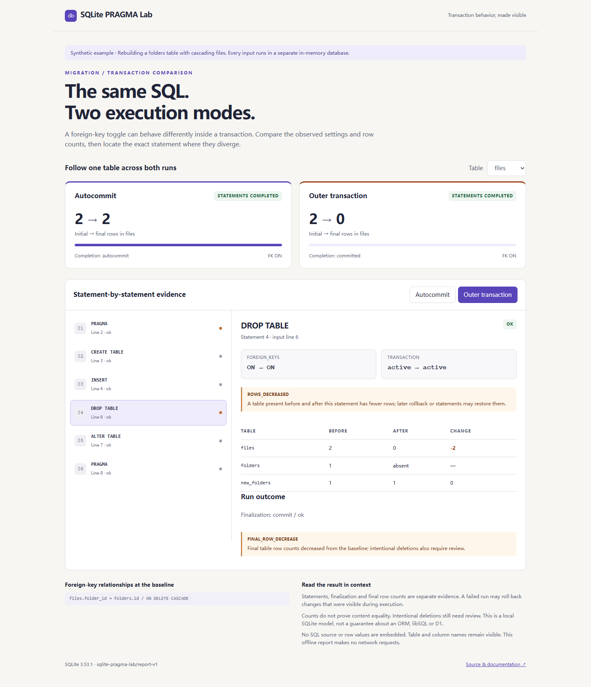

# SQLite Pragma Lab

[](https://github.com/7364588/sqlite-pragma-lab/actions/workflows/tests.yml)

[Live synthetic demo](https://7364588.github.io/sqlite-pragma-lab/) ·
[GitHub Releases](https://github.com/7364588/sqlite-pragma-lab/releases)

See how the same SQLite migration behaves in autocommit and inside a runner's
outer transaction. Run explicit SQL fixtures in memory and inspect effective
foreign-key settings, statement outcomes, and table row counts in a standalone
HTML report.



The included example rebuilds a parent table with `ON DELETE CASCADE` children.
Both profiles complete the SQL and pass final integrity and foreign-key checks.
Autocommit retains two child rows; the outer transaction retains zero. The report
identifies the ignored `PRAGMA foreign_keys=OFF` and the statement where rows fell.

## Try the synthetic example

Requires Python 3.11+ with SQLite foreign-key support. Runtime dependencies: none.
This project is **not published on PyPI**. Download
`sqlite_pragma_lab-0.1.0-py3-none-any.whl` from
[GitHub Releases](https://github.com/7364588/sqlite-pragma-lab/releases), then
install the downloaded wheel in a virtual environment:

```sh
python -m venv .venv
# Activate .venv using your shell's normal activation command.
python -m pip install ./sqlite_pragma_lab-0.1.0-py3-none-any.whl
sqlite-pragma-lab --help
```

The example SQL files are in the repository's `examples/folder-rebuild/`
directory, not inside the wheel. To install from a checkout and run them:

```sh
python -m venv .venv
# Activate .venv using your shell's normal activation command.
python -m pip install .
sqlite-pragma-lab run --schema examples/folder-rebuild/schema.sql --seed examples/folder-rebuild/seed.sql --migration examples/folder-rebuild/migration.sql --html comparison.html
```

This returns **exit 1**, because the result needs review. Open `comparison.html`
locally. Choose a profile and statement to inspect its before/after counts and
foreign-key relationships. The report works offline, with no external assets.
The [live demo](https://7364588.github.io/sqlite-pragma-lab/) uses only synthetic
data; its standalone HTML is also available at `docs/index.html` in a checkout.

For a clean additive change:

```sh
sqlite-pragma-lab run --schema examples/folder-rebuild/schema.sql --seed examples/folder-rebuild/seed.sql --migration examples/folder-rebuild/clean.sql --format json
```

This returns exit 0. `python -m sqlite_pragma_lab` is equivalent to the installed
console command. `--format json` writes the same evidence used by the HTML view.
`--html` requires a new destination and an existing parent directory; existing
files, including SQL inputs, are never overwritten.

| Exit | Meaning |
| --- | --- |
| 0 | Both profiles completed without an observed review finding. |
| 1 | Review is needed: observed loss, ignored toggle, empty baseline, failed statement/commit, or incomplete measurement. |
| 2 | Invalid input, failed baseline setup, or input/output failure. |

Exit 0 is an observation about this fixture and SQLite engine, not a migration
safety certificate. A deliberate deletion also requires review. Missing `--seed`
is allowed; if the resulting baseline has no rows, `EMPTY_BASELINE` prevents a
passing result from implying populated-data coverage.

## What is compared

Schema and optional seed statements build one in-memory baseline. Each section
must finish with no transaction open. Foreign keys are enabled before that
baseline is cloned into two isolated connections:

| Profile | Starting conditions | Finalization |
| --- | --- | --- |
| `autocommit` | Foreign keys ON, no runner transaction | Unclosed transactions in supplied SQL are rolled back and reported. |
| `outer_transaction` | Foreign keys ON, runner has executed BEGIN | Commit if still open after successful SQL; rollback if execution or commit fails. |

Explicit `BEGIN`, `COMMIT`, `ROLLBACK`, and savepoints are executed unchanged.
A nested `BEGIN` can fail. SQL that ends the outer transaction is reported, and
subsequent statements use their actual resulting transaction state. The lab does
not strip or rewrite transaction control. Triggers and quoted semicolons are
split with SQLite's statement-completeness check rather than a semicolon split.

Each statement has an ordinal, source line, kind, error code, before/after state,
and changes to table counts. `INSERT OR FAIL` and trigger errors can leave partial
effects, so the failed statement's observable after-state is recorded too.
The final state is measured separately after commit or rollback. A transient
decrease can therefore coexist with restored final counts. Deferred foreign-key
errors can occur at the runner's final commit even if every statement completed.

A missing table is `null` in a count comparison, not zero. An unavailable snapshot
is also explicit `null`; the report does not invent counts after interruption.
Foreign-key violations are grouped by table, parent, and constraint without row
IDs. Foreign-key edges explain relationships; an edge alone does not prove why a
row disappeared.

## Library

```python
from sqlite_pragma_lab import Limits, run_lab
from sqlite_pragma_lab.report import render_html

report = run_lab(
    "CREATE TABLE items(id INTEGER PRIMARY KEY);",
    "ALTER TABLE items ADD COLUMN label TEXT;",
    "INSERT INTO items VALUES(1);",
    limits=Limits(timeout_seconds=5),
)
assert report["status"] == "pass"
html = render_html(report)
```

`run_lab(schema_sql, migration_sql, seed_sql=None, *, limits=None)` returns a
JSON-compatible dictionary with schema `sqlite-pragma-lab/report-v1`.
Invalid or unsupported baseline input raises `LabError`; migration execution
errors are evidence within each profile. `engine.version` records the actual
SQLite library bundled with Python. `Limits` is available for library callers;
the CLI uses the defaults.

## Scope and limits

Only explicitly selected UTF-8 SQL files are read. There is no database-file
input, application discovery, ORM configuration evaluation, production apply,
network access, or migration generation. Reports omit SQL bodies, row values,
input paths, and raw database exception messages. They **do include table and
column identifiers**; review these before sharing a report.

The authorizer rejects ATTACH/DETACH, VACUUM INTO, extension loading, virtual
tables, TEMP objects, and user PRAGMAs other than `foreign_keys` and
`defer_foreign_keys`. SQLite internally required schema operations are permitted.
SQL runs with an in-memory journal and temporary storage. The CLI rejects symlink
input files and uses atomic no-clobber HTML publication via a same-directory hard
link; a filesystem without hard-link support returns exit 2. Output failure can
occur after an HTML report was successfully created.

Default budgets:

| Resource | Limit |
| --- | --- |
| Each SQL input / each statement | 1 MiB / 256 KiB |
| Combined schema, seed, migration statements | 512 |
| Tables / columns / foreign-key metadata entries | 64 / 128 / 512 |
| Main database pages | 4,096 × 4,096 bytes (16 MiB) |
| SQLite value or row size | 1 MiB |
| VM work / elapsed time | 2,000,000 steps / 5 seconds per execution phase |
| Recorded snapshot budget | Approximately 8 MiB per profile, excluding report overhead and final measurement |

Progress checks happen every 1,000 VM instructions. Baseline setup, each profile,
and each final recovery measurement have separate budgets. Additional SQLite
limits constrain expressions, compound SELECTs, trigger depth, and parameters.
The page budget is **not a process-memory cap**: intermediate query operations,
Python objects, and report rendering can use additional memory. This is a bounded
diagnostic tool for developer-controlled fixtures, not an OS sandbox for hostile
SQL. Use process isolation if your workflow accepts untrusted submissions.

Row counts do not detect same-count value corruption, row replacement, semantic
application errors, every schema change, or data loss that an earlier statement
restores before a snapshot. Only the supplied seed is exercised. This tool uses
stdlib SQLite; it does not certify libSQL, D1, Expo, a production engine version,
or an ORM's actual migration runner. Reproduce those environments separately.

## Why this exists

SQLite documents that changing foreign-key enforcement inside a transaction has
no effect, and its table-rebuild procedure depends on transaction boundaries.
Reports such as [Drizzle #4640](https://github.com/drizzle-team/drizzle-orm/issues/4640)
and [#4938](https://github.com/drizzle-team/drizzle-orm/issues/4938) describe
unexpected cascading deletion around table recreation. These motivate the
synthetic case; this project does not claim to reproduce every affected runtime
or repair those projects. Read SQLite's [foreign-key documentation](https://sqlite.org/foreignkeys.html)
and [ALTER TABLE procedure](https://sqlite.org/lang_altertable.html).

Generic rehearsal tools already exist, including
[sqlite-rehearsal](https://github.com/KanadeK/sqlite-rehearsal) and
[Atlas migration tests](https://atlasgo.io/testing/migrate). This project's focus
is a comparison of two actual transaction wrappers with effective PRAGMA state
and automatically recorded statement-level counts. It complements explicit
invariant tests; it does not replace them.

## Development

```sh
python -m pip install -e .
python -m unittest discover -s tests -v
python scripts/smoke.py
python scripts/demo.py
python -m pip install build
python -m build
```

Demo regeneration records the local SQLite version, so byte-for-byte results may
differ across Python distributions. CI checks semantics and installed-package
behavior on Windows, macOS, and Linux. See [CONTRIBUTING.md](CONTRIBUTING.md),
[SECURITY.md](SECURITY.md), and [MAINTENANCE.md](MAINTENANCE.md).

MIT licensed. Initial version: 0.1.0; report schema and scope may evolve.
